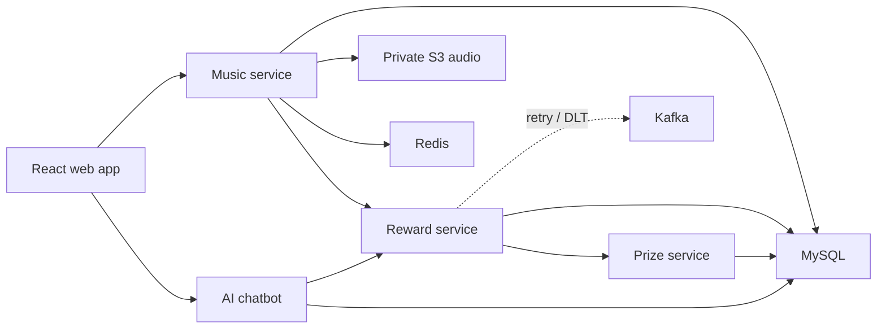

# Music Map

Music Map is a small listening app with a reward system behind it. Users can
discover and upload music, track listening time, and unlock coins, gems, or
coupons when configurable rules are met.

The interesting part of this repository is not the catalogue UI. It is the
path from a play event to a reward: four business services collaborate over HTTP through Eureka discovery,
failed prize deliveries go through Kafka retry and dead-letter topics, and
duplicate deliveries are made safe with an idempotency key.

## Learn Spring Cloud and Seata

Check out the [`codex/spring-cloud-microservices` branch](https://github.com/pl200x/RewardProject/tree/codex/spring-cloud-microservices)
to learn Spring Cloud service discovery, declarative HTTP clients, client-side load balancing,
and Seata distributed transactions through a working reward-delivery flow.

Use the following commands to switch to the learning branch:

```bash
git fetch origin
git switch codex/spring-cloud-microservices
```

- **Eureka service discovery**: the new [service-registry](service-registry) lets business services discover each other by service name.
- **Declarative calls with OpenFeign**: integration classes use `@FeignClient`; start with
  [PrizeClient](Multi_reward/src/main/java/com/example/Multi_reward/integration/client/PrizeClient.java).
- **Spring Cloud LoadBalancer**: `@LoadBalancerClient` configures round-robin routing across service instances;
  see [FeignClientConfig](Multi_reward/src/main/java/com/example/Multi_reward/config/FeignClientConfig.java).
- **Seata AT distributed transactions**: [RewardGrantService](Multi_reward/src/main/java/com/example/Multi_reward/service/impl/RewardGrantService.java)
  combines `@GlobalTransactional`, Feign XID propagation, data source proxies and `undo_log`
  to coordinate the inventory decrement and both services' reward records.
  A separate bean fixes transaction-proxy bypass during self-invocation while preserving Kafka retries and business-key idempotency.
- **Executable failure scenarios**: [SeataTransactionIT](Multi_reward/src/test/java/com/example/Multi_reward/transaction/SeataTransactionIT.java)
  demonstrates commit, cross-database rollback, concurrent replay and global-lock protection.
  Run `./scripts/verify-discovery.sh --full` to verify transactions, discovery and multi-instance load balancing in an isolated environment.

For startup instructions, see [Local development](#local-development). Transaction scope and configuration are covered in
[the Seata deployment guide](DEPLOY.md#10-seata-分布式发奖事务).

## How it fits together



| Directory | Role | Port |
| --- | --- | --- |
| `Music_management` | users, catalogue, uploads, playback and rankings | 8081 |
| `Multi_reward` | listening totals, rule evaluation and retry orchestration | 8080 |
| `PrizeCenter` | prize inventory and idempotent fulfilment | 8082 |
| `ai_chatbot` | authenticated AI assistant and per-user chat history | 8083 |
| `service-registry` | Eureka registration and discovery | 8761 |
| `frontend` | React/Vite user and admin interface | 5173 locally |

The production container serves the frontend and proxies `/api/music`,
`/api/reward`, `/api/prize`, and only the exact `/api/chatbot/chat` endpoint,
so the backend ports and chat-history CRUD endpoints stay private. Chat requests
require the same JWT issued by the music service and are rate-limited by nginx.

## A few design choices

- Reward rules live in MySQL and are evaluated with JEXL, so thresholds can be
  changed without rebuilding the services.
- Prize requests carry an `out_biz_no`. A unique constraint prevents a Kafka
  replay or HTTP retry from paying the same reward twice.
- Failed prize delivery is retried through Kafka and eventually moved to a
  dead-letter topic for inspection or replay.
- Audio objects stay private in Amazon S3. The music service returns a
  one-hour presigned URL when a browser needs to play a track.
- Passwords are BCrypt hashes and authenticated write requests use JWTs.

## Reliability: retry and dead-letter topics

Prize dispatch moves value, so failures are sent to `REWARD_RETRY_TOPIC`.
The retry consumer dispatches them again, with bounded in-place retries, before
unrecoverable messages are routed to `REWARD_RETRY_TOPIC.DLT` for inspection.

- Corrupted payloads skip wasteful retries and go directly to the DLT.
- Replay is safe because prize dispatch is idempotent on `out_biz_no`; the
  database unique key prevents a replay from paying twice.
- Music and notification consumers use the same pattern through `MUSIC.DLT`
  and `NOTIFICATION.DLT`.
- After the downstream service recovers, operators can review and deliberately
  republish a preserved DLT payload to its retry topic.

## Local development

The recommended development setup keeps the frontend and Java services on the
host, where IDE debugging and rebuilds are fast, and runs only the middleware
in Docker. MinIO provides the S3-compatible API used by the production code.

```bash
cp .env.local.example .env.local
# Add OPENAI_API_KEY to the git-ignored .env.local.

./scripts/local-infra.sh start
./scripts/start-all.sh
```

Open <http://localhost:5173>. Local middleware is bound only to `127.0.0.1`:
MySQL `13306`, Redis `16379`, Kafka `19092`, Seata `18091`, and MinIO S3 `19000`
(console `19001`). On first startup MySQL imports `sql/`, and MinIO creates the private `music`
bucket. Data stays in named Docker volumes across normal stops.

The MinIO console uses the local-only `AWS_ACCESS_KEY_ID` and
`AWS_SECRET_ACCESS_KEY` values from `.env.local`.

```bash
./scripts/status.sh
./scripts/local-infra.sh status
./scripts/stop-all.sh
./scripts/local-infra.sh stop
```

The local and production storage paths use the same AWS SDK code. `.env.local`
only adds a local endpoint and test credentials; `docker-compose.yml` and the
AWS deployment remain unchanged.

## Production-style Docker run

You need Docker, an Amazon S3 bucket, and AWS credentials that can read and
write the bucket. On EC2, use an instance IAM role instead of access keys.

```bash
git clone https://github.com/pl200x/RewardProject.git
cd RewardProject

cp .env.example .env
# Set DB_PASSWORD, JWT_SECRET, OPENAI_API_KEY, AWS_REGION and S3_BUCKET.
# For local development, also provide an AWS profile or temporary credentials.

docker compose up -d --build
docker compose ps
```

Open <http://localhost>. MySQL schemas and seed data are loaded from `sql/`
the first time the database volume is created.

If an existing MySQL volume predates `sql/07_ai_chatbot.sql`, apply that
idempotent migration once before starting the chatbot:

```bash
docker compose exec -T mysql sh -c 'exec mysql -uroot -p"$MYSQL_ROOT_PASSWORD"' < sql/07_ai_chatbot.sql
```

Useful smoke checks:

```bash
curl http://localhost/api/music/music/list
curl http://localhost/api/reward/config/searchall
curl http://localhost/api/prize/prize/getallprize
```

Then log in through the browser and send a chatbot message. Anonymous requests
to `/api/chatbot/chat` should return HTTP 401; bursts above the configured limit
should return HTTP 429.

To build without Docker:

```bash
mvn package -DskipTests
cd frontend && npm ci && npm run build
```

With the local middleware (including Seata) running and its environment variables loaded,
use `mvn test` for the default test suite. The isolated `--full` verification script also runs integration tests.
The five Maven modules can also be started independently. Environment
variables and local helper scripts are documented in `.env.example` and
`scripts/`.

## Deploying and moving existing audio

- [AWS deployment guide](DEPLOY.md) covers EC2, IAM, S3, Docker Compose and
  HTTPS.
- [`scripts/migrate-minio-to-s3.sh`](scripts/migrate-minio-to-s3.sh) exports
  the old MinIO bucket, keeps a local rollback copy, and uploads the MP3 files
  to S3.

## Spring Cloud migration plan

The migration keeps the existing REST contracts and integration classes. Work proceeds
on `codex/spring-cloud-microservices` from local `main` (`f2b617f`):

1. Add a standalone Eureka registry and register the four existing applications.
2. Pilot Reward's read-only `GET /prize_reward/count` using a discovery-backed
   Feign client. Verify discovery, two instances, removal and timeouts.
3. After the pilot passes, migrate the remaining reads, playback POST, and prize POST.
   Preserve JWT checks, response envelopes, `out_biz_no` and Kafka retry/DLT behavior.
4. Add bounded timeouts, correlation/instance logging, deployment configuration and
   an explicit direct-routing rollback profile. Never retry writes automatically.
5. Run the repository checks and real multi-instance verification before rollout.

Implementation and acceptance details:

| Stage | Main files | Verification |
| --- | --- | --- |
| Registry and dependencies | Root `pom.xml`, `service-registry/`, and the four business modules' `pom.xml` files | Build all five modules; register, query and deregister with a real Eureka server |
| Registration and identity | Each module's `application.properties` | `music-service`, `reward-service`, `prize-service` and `chatbot-service` register as UP |
| Read-only pilot | `Multi_reward/.../integration/CheckScheduleIntegration.java`, `client/PrizeClient.java`, `FeignClientConfig.java` | `DiscoveryLoadBalancerIT` uses real Feign proxies to cover one instance, round robin, DOWN status, removal and timeouts |
| Remaining internal calls | `MusicIntegration`, `PrizeIntegration`, `AIChatIntegration` | Preserve DTOs, paths, business errors and authentication; exercise real Music → Reward → Prize and Chatbot → Reward calls |
| Timeouts, context and routing rollback | Three `InternalFeignConfiguration` classes, four `RequestContextFilter` classes, `application-direct.properties`, logging configuration | Disable Feign/LoadBalancer retries; propagate request IDs and the active Seata XID on Reward → Prize calls; verify the direct-routing profile |
| Multi-instance write protection | `PrizeServiceImpl`, `PrizeMapper` and its XML | Real MySQL concurrent inventory decrements, replay after stock exhaustion, and transaction rollback |
| Deployment and continuous verification | Compose, local scripts, CI, `scripts/verify-discovery.*`, [DEPLOY.md](DEPLOY.md#9-spring-cloud-迁移与回滚) | Route across two real Reward/Prize processes, recover from registry outages and discover relocated instances |

Before migration, callers used `MULTIREWARD_BASE_URL` / `PRIZECENTER_BASE_URL` to address downstream hosts.
Eureka now supplies instance lists, Spring Cloud LoadBalancer selects an instance in the caller,
and the HTTP request goes directly to that instance:

```text
Browser → nginx → Music / Reward / Prize / Chatbot

Music ── reward-service ──→ Reward A / B
Chatbot ─ reward-service ─→ Reward A / B
Reward ── prize-service ──→ Prize A / B

All four services ← register / fetch → Eureka :8761
```

Internal calls use Spring Cloud OpenFeign. Three `@FeignClient` interfaces declare eight HTTP methods
and are explicitly enabled with `@EnableFeignClients`. Integration classes retain business-response
validation and local reward-record logic, without constructing URLs or calling RestTemplate directly.
Feign still uses HTTP/REST to call the existing controllers.

| Caller | Feign interface | Methods |
| --- | --- | --- |
| Music_management | `integration/client/RewardClient.java`, name=`reward-service` | POST `/sync` |
| Multi_reward | `integration/client/PrizeClient.java`, name=`prize-service` | POST `/prize/send_reward`; two reconciliation GETs |
| ai_chatbot | `integration/client/RewardClient.java`, name=`reward-service` | Four GETs for reward date ranges, business dates, play records and reward configuration |

Normal operation leaves Feign's `url` unset, so `name` selects the service through Eureka and
Spring Cloud LoadBalancer. The `direct` profile supplies a physical URL from the original environment
variables, explicitly bypassing discovery.

All three callers bind a round-robin policy through `@LoadBalancerClient` on `FeignClientConfig`.
Music and Chatbot target `reward-service`; Reward targets `prize-service`.
Each caller's `integration/loadbalancer/RoundRobinConfiguration.java` supplies a `RoundRobinLoadBalancer`.
The configuration loads only in the corresponding service's LoadBalancer child context.
This makes the existing default round-robin behavior explicit while keeping the `@FeignClient` API.
`@LoadBalanced` is normally applied to RestTemplate/RestClient or WebClient.Builder;
this project uses the configuration appropriate for Feign. See the
[Spring Cloud LoadBalancer documentation](https://docs.spring.io/spring-cloud-commons/reference/spring-cloud-commons/loadbalancer.html).

With a stable instance list, a caller distributes requests to the same service in rotation;
the first selected instance is not fixed. Selection state belongs to each caller process and target
service, so separate callers or individual API paths do not necessarily alternate independently.
Each selection logs `event=LOAD_BALANCER_SELECTED` with requestId, targetService, targetInstance,
targetHost and targetPort, without changing request headers or business data.
The `direct` profile uses a fixed URL and bypasses instance selection.

Each `InternalFeignConfiguration` applies only to its designated Feign clients. It sets bounded
timeouts, `Retryer.NEVER_RETRY`, request-ID propagation and logging that excludes request bodies and
query parameters. Reward also propagates the active Seata XID to Prize. Automatic redirects are
disabled, and the JDK HTTP transport is retained so external SDK dependencies do not change Feign's
transport selection. See the [Spring Cloud OpenFeign documentation](https://docs.spring.io/spring-cloud-openfeign/reference/spring-cloud-openfeign.html).

Eureka fits the existing Maven, Docker and local-script setup without adding Consul or Nacos.
Feign handles declarative calls; this migration does not require WebClient, Gateway, Config Server
or Resilience4j. The nginx entry point and environment-variable configuration remain in use.
S3 SDK, SMTP, OpenAI, MySQL, Redis and Kafka retain their existing access patterns.

Java 17 is unchanged. Music, Reward and Prize use Boot 3.4.3 with Cloud BOM 2024.0.3;
Chatbot and Registry use Boot 4.0.7 with Cloud BOM 2025.1.2. Each module manages its own Boot parent.
References: [Spring Cloud compatibility matrix](https://spring.io/projects/spring-cloud/),
[2024.0.3 release notes](https://spring.io/blog/2025/12/12/spring-cloud-2024-0-3-aka-northfields-has-been-released/), and
[2025.1 release notes](https://github.com/spring-cloud/spring-cloud-release/wiki/Spring-Cloud-2025.1-Release-Notes).
The 2024.0 release train has reached the end of open-source support. A production version upgrade
needs separate validation; passing the local tests does not establish a supported production baseline.

Verification commands (Java 17, Maven, Docker Compose and Python 3 required):

```bash
# Use local test infrastructure. Never point RUN_DATABASE_TESTS at production databases.
./scripts/local-infra.sh start
set -a
source .env.local.example
set +a
export OPENAI_API_KEY=test-key DISCOVERY_ENABLED=false RECONCILIATION_ENABLED=false RUN_DATABASE_TESTS=true
mvn -B -Pdiscovery-it verify

# Create isolated infrastructure, build and run real services, then remove only this run's resources.
./scripts/verify-discovery.sh

# Also run the full Maven suite in the isolated environment.
./scripts/verify-discovery.sh --full

cd frontend
npm run build
```

`DiscoveryLoadBalancerIT` uses real Eureka and real clients with HTTP fixtures for downstream responses.
`verify-discovery.sh` uses real business JVMs, MySQL, Redis, Kafka, MinIO and Seata; only OpenAI is
replaced by a local fixture. It exercises JWT → Chatbot → tool → Reward without making external model calls.
Results and per-instance logs are retained under `target/discovery-smoke/`, including on failure.
Existing JUnit 4 tests do not run under the current JUnit Platform without Vintage; the counts below
do not claim coverage of those legacy classes.

Local Feign and explicit load-balancing results before Seata integration (2026-10-05):

| Check | Result |
| --- | --- |
| `mvn -B -Pdiscovery-it clean verify` inside `scripts/verify-discovery.sh --full` | VERIFIED: 66 tests, zero failures/errors/skips; all five modules rebuilt from clean output directories |
| Real-service checks in the same script | VERIFIED: 20 checks; Music → Reward → Prize and Chatbot → Reward use Feign, including multi-instance routing, recovery and port relocation |
| Explicit round robin and instance logs | VERIFIED: Reward's 10 read requests alternate 5/5; Music's 12 requests split 6/6; Chatbot's four requests split 2/2; all three callers log both downstream instances |
| Feign contracts and direct-routing fallback | VERIFIED: paths, parameters, JSON, business errors, empty responses and request IDs for all eight methods; no retries on direct-mode timeouts or HTTP 503 |
| Legacy configuration cleanup | VERIFIED: the three callers' sources and executable JARs no longer contain the original RestTemplate configuration classes |
| `git diff --check` and script syntax | VERIFIED |

Earlier local migration and frontend results (2026-10-04; frontend code was unchanged by the Feign migration):

| Check | Result |
| --- | --- |
| `mvn -B -Pdiscovery-it verify` with database tests enabled | VERIFIED: 64 tests, zero failures/errors/skips; all five executable modules built |
| `scripts/verify-discovery.sh` | VERIFIED: 15 real-service checks, including concurrent inventory updates across two JVMs, registry restart and port relocation |
| `npm run build` | VERIFIED: TypeScript and Vite build succeeded |
| `npm audit --omit=dev` | FAILED: the existing Axios production dependency reported one high-severity vulnerability; frontend dependencies were unchanged by the migration |
| Compose configuration, Shell/Python syntax, `git diff --check` | VERIFIED |
| Two physical hosts, production deployment, real OpenAI/S3 cloud calls | NOT RUN: these external environments were outside local verification |

Rollout boundaries: Prize uses transactional idempotency records and atomic inventory decrements.
Reward's daily user summary still has a concurrent read-then-insert/update risk that needs separate
validation and fixes before unrestricted scaling of same-user writes. Enable Reward reconciliation
on only one instance. Chatbot's conversation memory is process-local, so keep it on one instance.
Multi-instance tests use separate processes on one machine; multi-host networking and production
rolling deployment still require staging verification.

## Current boundaries

This is intentionally a single-node deployment for a demo-sized workload.
MySQL, Redis and Kafka run on the same EC2 instance; a production system would
move those responsibilities to managed, multi-AZ services.

JWT authentication is present, but administrator role separation is not yet
implemented. Do not expose the admin interface as a multi-tenant production
service until RBAC and an audit trail are added.


## Seata reward transactions

Reward → Prize uses Seata AT. `@GlobalTransactional` on the separate `RewardGrantService` coordinates
Prize inventory, Prize reward records and Reward reward records. `@Transactional` still manages each
local branch. Feign propagates XID, and Prize clears the request's transaction context on completion.
Both the normal flow and Kafka retries enter through the transaction proxy. Failures trigger global
rollback, and replaying the same business key does not spend inventory twice.

For local startup, run `./scripts/local-infra.sh start`, then `./scripts/start-all.sh`.
The infrastructure script starts Seata at `127.0.0.1:18091` by default and adds `undo_log` to existing
business databases without deleting data volumes. Run `./scripts/verify-discovery.sh --full` to
verify cross-service commit and failure rollback in an isolated environment.

For transaction scope, deployment settings and AT visibility/recovery limits, see the
[Seata deployment guide](DEPLOY.md#10-seata-分布式发奖事务).

Local results after Seata integration (2026-10-05): `./scripts/verify-discovery.sh --full` passed
75 Maven tests, including six real Seata integration tests, with zero failures/errors/skips.
All 20 real multi-instance service checks also passed. Coverage includes rollback after inventory
has been decremented, proxy interception in the normal flow, fresh retry XIDs, concurrent replay,
global-lock protection for standalone record deletion, discovery and load balancing.

GitHub Actions results for commit [`b79307a`](https://github.com/pl200x/RewardProject/commit/b79307ab13f3a92f4d697511f6d9dbec100a05a2)
(2026-10-07) differ from those local results:

- [Backend CI](https://github.com/pl200x/RewardProject/actions/runs/37658708146)
  failed while pulling `minio/minio`: the registry returned `pull access denied`.
  Infrastructure setup stopped before Maven or the Seata tests ran.
- [Frontend CI](https://github.com/pl200x/RewardProject/actions/runs/37658708229)
  failed at `npm audit --omit=dev --audit-level=moderate`. The lockfile selects Axios 1.18.1,
  and the audit reported one high-severity vulnerable dependency with multiple advisories.
  The subsequent frontend build step was skipped.

To restore CI, make the pinned MinIO images available to a fresh runner, update Axios and its
lockfile to a patched version, then rerun the audit, build and integration checks.
