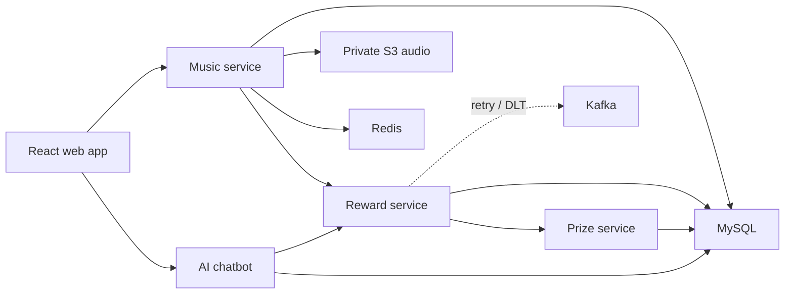

# Music Map

Music Map is a small listening app with a reward system behind it. Users can
discover and upload music, track listening time, and unlock coins, gems, or
coupons when configurable rules are met.

The interesting part of this repository is not the catalogue UI. It is the
path from a play event to a reward: four services collaborate over HTTP,
failed prize deliveries go through Kafka retry and dead-letter topics, and
duplicate deliveries are made safe with an idempotency key.

## How it fits together



| Directory | Role | Port |
| --- | --- | --- |
| `Music_management` | users, catalogue, uploads, playback and rankings | 8081 |
| `Multi_reward` | listening totals, rule evaluation and retry orchestration | 8080 |
| `PrizeCenter` | prize inventory and idempotent fulfilment | 8082 |
| `ai_chatbot` | authenticated AI assistant and per-user chat history | 8083 |
| `frontend` | React/Vite user and admin interface | 5173 locally |

The production container serves the frontend and proxies `/api/music`,
`/api/reward`, `/api/prize`, and only the exact `/api/chatbot/chat` endpoint,
so the backend ports and chat-history CRUD endpoints stay private. Chat requests
require the same JWT issued by the music service and are rate-limited by nginx.

## A few design choices

- Reward rules live in MySQL and are evaluated with JEXL, so thresholds can be
  changed without rebuilding the services.
- Prize requests carry an `out_biz_no`. A unique constraint prevents a Kafka
  replay or HTTP retry from paying the same reward twice.
- Failed prize delivery is retried through Kafka and eventually moved to a
  dead-letter topic for inspection or replay.
- Audio objects stay private in Amazon S3. The music service returns a
  one-hour presigned URL when a browser needs to play a track.
- Passwords are BCrypt hashes and authenticated write requests use JWTs.

## Reliability: retry and dead-letter topics

Prize dispatch moves value, so failures are sent to `REWARD_RETRY_TOPIC`.
The retry consumer dispatches them again, with bounded in-place retries, before
unrecoverable messages are routed to `REWARD_RETRY_TOPIC.DLT` for inspection.

- Corrupted payloads skip wasteful retries and go directly to the DLT.
- Replay is safe because prize dispatch is idempotent on `out_biz_no`; the
  database unique key prevents a replay from paying twice.
- Music and notification consumers use the same pattern through `MUSIC.DLT`
  and `NOTIFICATION.DLT`.
- After the downstream service recovers, operators can review and deliberately
  republish a preserved DLT payload to its retry topic.

## Local development

The recommended development setup keeps the frontend and Java services on the
host, where IDE debugging and rebuilds are fast, and runs only the middleware
in Docker. MinIO provides the S3-compatible API used by the production code.

```bash
cp .env.local.example .env.local
# Add OPENAI_API_KEY to the git-ignored .env.local.

./scripts/local-infra.sh start
./scripts/start-all.sh
```

Open <http://localhost:5173>. Local middleware is bound only to `127.0.0.1`:
MySQL `13306`, Redis `16379`, Kafka `19092`, and MinIO S3 `19000` (console
`19001`). On first startup MySQL imports `sql/`, and MinIO creates the private `music`
bucket. Data stays in named Docker volumes across normal stops.

The MinIO console uses the local-only `AWS_ACCESS_KEY_ID` and
`AWS_SECRET_ACCESS_KEY` values from `.env.local`.

```bash
./scripts/status.sh
./scripts/local-infra.sh status
./scripts/stop-all.sh
./scripts/local-infra.sh stop
```

The local and production storage paths use the same AWS SDK code. `.env.local`
only adds a local endpoint and test credentials; `docker-compose.yml` and the
AWS deployment remain unchanged.

## Production-style Docker run

You need Docker, an Amazon S3 bucket, and AWS credentials that can read and
write the bucket. On EC2, use an instance IAM role instead of access keys.

```bash
git clone https://github.com/pl200x/RewardProject.git
cd RewardProject

cp .env.example .env
# Set DB_PASSWORD, JWT_SECRET, OPENAI_API_KEY, AWS_REGION and S3_BUCKET.
# For local development, also provide an AWS profile or temporary credentials.

docker compose up -d --build
docker compose ps
```

Open <http://localhost>. MySQL schemas and seed data are loaded from `sql/`
the first time the database volume is created.

If an existing MySQL volume predates `sql/07_ai_chatbot.sql`, apply that
idempotent migration once before starting the chatbot:

```bash
docker compose exec -T mysql sh -c 'exec mysql -uroot -p"$MYSQL_ROOT_PASSWORD"' < sql/07_ai_chatbot.sql
```

Useful smoke checks:

```bash
curl http://localhost/api/music/music/list
curl http://localhost/api/reward/config/searchall
curl http://localhost/api/prize/prize/getallprize
```

Then log in through the browser and send a chatbot message. Anonymous requests
to `/api/chatbot/chat` should return HTTP 401; bursts above the configured limit
should return HTTP 429.

To build without Docker:

```bash
mvn package -DskipTests
cd frontend && npm ci && npm run build
```

With MySQL, Redis and Kafka running, use `mvn test` for the integration tests.
The four Maven modules can also be started independently. Environment
variables and local helper scripts are documented in `.env.example` and
`scripts/`.

## Deploying and moving existing audio

- [AWS deployment guide](DEPLOY.md) covers EC2, IAM, S3, Docker Compose and
  HTTPS.
- [`scripts/migrate-minio-to-s3.sh`](scripts/migrate-minio-to-s3.sh) exports
  the old MinIO bucket, keeps a local rollback copy, and uploads the MP3 files
  to S3.

## Current boundaries

This is intentionally a single-node deployment for a demo-sized workload.
MySQL, Redis and Kafka run on the same EC2 instance; a production system would
move those responsibilities to managed, multi-AZ services.

JWT authentication is present, but administrator role separation is not yet
implemented. Do not expose the admin interface as a multi-tenant production
service until RBAC and an audit trail are added.
