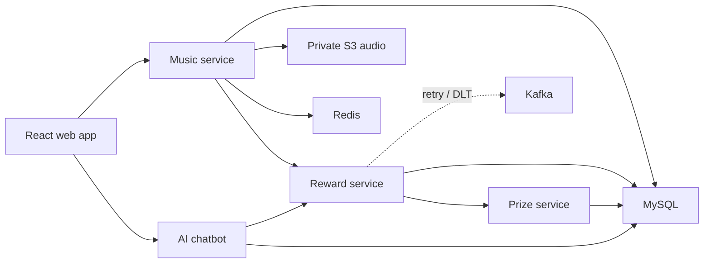

# Music Map

Music Map is a small listening app with a reward system behind it. Users can
discover and upload music, track listening time, and unlock coins, gems, or
coupons when configurable rules are met.

The interesting part of this repository is not the catalogue UI. It is the
path from a play event to a reward: four business services collaborate over HTTP through Eureka discovery,
failed prize deliveries go through Kafka retry and dead-letter topics, and
duplicate deliveries are made safe with an idempotency key.

## Learn Spring Cloud and Seata

Check out the [`codex/spring-cloud-microservices` branch](https://github.com/pl200x/RewardProject/tree/codex/spring-cloud-microservices)
to learn Spring Cloud service discovery, declarative HTTP clients, client-side load balancing,
and Seata distributed transactions through a working reward-delivery flow.

可以检出这个分支，结合代码和测试学习 **Spring Cloud 与 Seata**：

```bash
git fetch origin
git switch codex/spring-cloud-microservices
```

- **Eureka 服务发现**：新增 [service-registry](service-registry)，业务服务通过服务名发现彼此。
- **OpenFeign 声明式调用**：integration 层使用 `@FeignClient`；例如
  [PrizeClient](Multi_reward/src/main/java/com/example/Multi_reward/integration/client/PrizeClient.java)。
- **Spring Cloud LoadBalancer**：通过 `@LoadBalancerClient` 配置轮询，在多个服务实例之间分配请求；
  见 [FeignClientConfig](Multi_reward/src/main/java/com/example/Multi_reward/config/FeignClientConfig.java)。
- **Seata AT 分布式事务**：[RewardGrantService](Multi_reward/src/main/java/com/example/Multi_reward/service/impl/RewardGrantService.java)
  使用 `@GlobalTransactional`，配合 Feign XID 传递、数据源代理和 `undo_log`，统一管理 Prize 扣库存及双方发奖流水。
  独立 Bean 修复了同类调用绕过事务代理的问题，并保留 Kafka 重试与业务单号幂等。
- **可运行的故障验证**：[SeataTransactionIT](Multi_reward/src/test/java/com/example/Multi_reward/transaction/SeataTransactionIT.java)
  演示提交、跨库回滚、并发重放和全局锁保护；运行 `./scripts/verify-discovery.sh --full`
  可在隔离环境中同时验证事务、服务发现和多实例负载均衡。

本地启动见下方 [Local development](#local-development)，事务范围与部署配置见
[Seata 部署说明](DEPLOY.md#10-seata-分布式发奖事务)。

## How it fits together



| Directory | Role | Port |
| --- | --- | --- |
| `Music_management` | users, catalogue, uploads, playback and rankings | 8081 |
| `Multi_reward` | listening totals, rule evaluation and retry orchestration | 8080 |
| `PrizeCenter` | prize inventory and idempotent fulfilment | 8082 |
| `ai_chatbot` | authenticated AI assistant and per-user chat history | 8083 |
| `service-registry` | Eureka registration and discovery | 8761 |
| `frontend` | React/Vite user and admin interface | 5173 locally |

The production container serves the frontend and proxies `/api/music`,
`/api/reward`, `/api/prize`, and only the exact `/api/chatbot/chat` endpoint,
so the backend ports and chat-history CRUD endpoints stay private. Chat requests
require the same JWT issued by the music service and are rate-limited by nginx.

## A few design choices

- Reward rules live in MySQL and are evaluated with JEXL, so thresholds can be
  changed without rebuilding the services.
- Prize requests carry an `out_biz_no`. A unique constraint prevents a Kafka
  replay or HTTP retry from paying the same reward twice.
- Failed prize delivery is retried through Kafka and eventually moved to a
  dead-letter topic for inspection or replay.
- Audio objects stay private in Amazon S3. The music service returns a
  one-hour presigned URL when a browser needs to play a track.
- Passwords are BCrypt hashes and authenticated write requests use JWTs.

## Reliability: retry and dead-letter topics

Prize dispatch moves value, so failures are sent to `REWARD_RETRY_TOPIC`.
The retry consumer dispatches them again, with bounded in-place retries, before
unrecoverable messages are routed to `REWARD_RETRY_TOPIC.DLT` for inspection.

- Corrupted payloads skip wasteful retries and go directly to the DLT.
- Replay is safe because prize dispatch is idempotent on `out_biz_no`; the
  database unique key prevents a replay from paying twice.
- Music and notification consumers use the same pattern through `MUSIC.DLT`
  and `NOTIFICATION.DLT`.
- After the downstream service recovers, operators can review and deliberately
  republish a preserved DLT payload to its retry topic.

## Local development

The recommended development setup keeps the frontend and Java services on the
host, where IDE debugging and rebuilds are fast, and runs only the middleware
in Docker. MinIO provides the S3-compatible API used by the production code.

```bash
cp .env.local.example .env.local
# Add OPENAI_API_KEY to the git-ignored .env.local.

./scripts/local-infra.sh start
./scripts/start-all.sh
```

Open <http://localhost:5173>. Local middleware is bound only to `127.0.0.1`:
MySQL `13306`, Redis `16379`, Kafka `19092`, and MinIO S3 `19000` (console
`19001`). On first startup MySQL imports `sql/`, and MinIO creates the private `music`
bucket. Data stays in named Docker volumes across normal stops.

The MinIO console uses the local-only `AWS_ACCESS_KEY_ID` and
`AWS_SECRET_ACCESS_KEY` values from `.env.local`.

```bash
./scripts/status.sh
./scripts/local-infra.sh status
./scripts/stop-all.sh
./scripts/local-infra.sh stop
```

The local and production storage paths use the same AWS SDK code. `.env.local`
only adds a local endpoint and test credentials; `docker-compose.yml` and the
AWS deployment remain unchanged.

## Production-style Docker run

You need Docker, an Amazon S3 bucket, and AWS credentials that can read and
write the bucket. On EC2, use an instance IAM role instead of access keys.

```bash
git clone https://github.com/pl200x/RewardProject.git
cd RewardProject

cp .env.example .env
# Set DB_PASSWORD, JWT_SECRET, OPENAI_API_KEY, AWS_REGION and S3_BUCKET.
# For local development, also provide an AWS profile or temporary credentials.

docker compose up -d --build
docker compose ps
```

Open <http://localhost>. MySQL schemas and seed data are loaded from `sql/`
the first time the database volume is created.

If an existing MySQL volume predates `sql/07_ai_chatbot.sql`, apply that
idempotent migration once before starting the chatbot:

```bash
docker compose exec -T mysql sh -c 'exec mysql -uroot -p"$MYSQL_ROOT_PASSWORD"' < sql/07_ai_chatbot.sql
```

Useful smoke checks:

```bash
curl http://localhost/api/music/music/list
curl http://localhost/api/reward/config/searchall
curl http://localhost/api/prize/prize/getallprize
```

Then log in through the browser and send a chatbot message. Anonymous requests
to `/api/chatbot/chat` should return HTTP 401; bursts above the configured limit
should return HTTP 429.

To build without Docker:

```bash
mvn package -DskipTests
cd frontend && npm ci && npm run build
```

With MySQL, Redis and Kafka running, use `mvn test` for the integration tests.
The five Maven modules can also be started independently. Environment
variables and local helper scripts are documented in `.env.example` and
`scripts/`.

## Deploying and moving existing audio

- [AWS deployment guide](DEPLOY.md) covers EC2, IAM, S3, Docker Compose and
  HTTPS.
- [`scripts/migrate-minio-to-s3.sh`](scripts/migrate-minio-to-s3.sh) exports
  the old MinIO bucket, keeps a local rollback copy, and uploads the MP3 files
  to S3.

## Spring Cloud migration plan

The migration keeps the existing REST contracts and integration classes. Work proceeds
on `codex/spring-cloud-microservices` from local `main` (`f2b617f`):

1. Add a standalone Eureka registry and register the four existing applications.
2. Pilot Reward's read-only `GET /prize_reward/count` using a discovery-backed
   Feign client. Verify discovery, two instances, removal and timeouts.
3. After the pilot passes, migrate the remaining reads, playback POST, and prize POST.
   Preserve JWT checks, response envelopes, `out_biz_no` and Kafka retry/DLT behavior.
4. Add bounded timeouts, correlation/instance logging, deployment configuration and
   an explicit direct-routing rollback profile. Never retry writes automatically.
5. Run the repository checks and real multi-instance verification before rollout.

Implementation and acceptance details (中文):

| 阶段 | 主要文件 | 验收方式 |
| --- | --- | --- |
| 注册中心与依赖 | 根 `pom.xml`、`service-registry/`、四个业务模块的 `pom.xml` | 五模块构建；真实 Eureka 注册、查询、注销 |
| 服务注册与身份 | 四个模块的 `application.properties` | `music-service`、`reward-service`、`prize-service`、`chatbot-service` 注册为 UP |
| 只读试点 | `Multi_reward/.../integration/CheckScheduleIntegration.java`、`client/PrizeClient.java`、`FeignClientConfig.java` | `DiscoveryLoadBalancerIT` 使用真实 Feign 代理覆盖单实例、轮询、DOWN、移除、超时 |
| 其余内部调用 | `MusicIntegration`、`PrizeIntegration`、`AIChatIntegration` | 原 DTO、路径、业务错误、鉴权测试；真实 Music → Reward → Prize、Chatbot → Reward 调用 |
| 超时、上下文与回滚 | 三个 `InternalFeignConfiguration`、四个 `RequestContextFilter`、`application-direct.properties`、日志配置 | Feign 与 LoadBalancer 重试关闭；仅透传 X-Request-ID；直接寻址 profile 回归 |
| 多实例写入保护 | `PrizeServiceImpl`、`PrizeMapper` 及 XML | 真实 MySQL 并发扣库存、库存耗尽后幂等重放、失败事务回滚 |
| 部署与持续验收 | Compose、本地启动脚本、CI、`scripts/verify-discovery.*`、[DEPLOY.md](DEPLOY.md#9-spring-cloud-迁移与回滚) | 两个真实 Reward/Prize 进程分发、注册中心故障恢复、实例换端口 |

迁移前，三个调用方通过 `MULTIREWARD_BASE_URL` / `PRIZECENTER_BASE_URL` 知道下游物理地址。
迁移后，Eureka 提供实例列表，Spring Cloud LoadBalancer 在调用方选择实例，HTTP 直接到达下游：

```text
Browser → nginx → Music / Reward / Prize / Chatbot

Music ── reward-service ──→ Reward A / B
Chatbot ─ reward-service ─→ Reward A / B
Reward ── prize-service ──→ Prize A / B

All four services ← register / fetch → Eureka :8761
```

内部调用统一采用 Spring Cloud OpenFeign：三个 `@FeignClient` 接口声明八个 HTTP 方法，
由 `@EnableFeignClients` 显式启用。integration 类保留业务 envelope 校验和本地发奖流水逻辑，
不再拼接 URL 或直接使用 RestTemplate。Feign 底层仍通过 HTTP/REST 调用原有 Controller。

| 调用方 | Feign 接口 | 方法 |
| --- | --- | --- |
| Music_management | `integration/client/RewardClient.java`，name=`reward-service` | POST `/sync` |
| Multi_reward | `integration/client/PrizeClient.java`，name=`prize-service` | POST `/prize/send_reward`；两个对账 GET |
| ai_chatbot | `integration/client/RewardClient.java`，name=`reward-service` | 奖励日期区间、业务日期、播放记录和奖励配置四个 GET |

常规模式不配置 Feign `url`，由 name 关联 Eureka 和 Spring Cloud LoadBalancer。
`direct` profile 使用原环境变量为注解的 `url` 占位符提供物理地址，从而显式绕过发现。

三个调用方通过 `FeignClientConfig` 上的 `@LoadBalancerClient` 显式绑定轮询策略。
Music、Chatbot 绑定 `reward-service`，Reward 绑定 `prize-service`；各自的
`integration/loadbalancer/RoundRobinConfiguration.java` 提供 `RoundRobinLoadBalancer`。
配置类只在对应服务的 LoadBalancer 子容器中加载，避免影响其他服务。
已有默认轮询能力由此变为显式配置，调用方式仍为 `@FeignClient`。
`@LoadBalanced` 通常用于 RestTemplate/RestClient 或 WebClient.Builder；这里使用 Feign
对应的配置方式，见 [Spring Cloud LoadBalancer 文档](https://docs.spring.io/spring-cloud-commons/reference/spring-cloud-commons/loadbalancer.html)。

实例列表稳定时，一个调用方对同一服务的请求按实例轮流分发，首次选中哪个实例不固定。
计数按调用方进程和目标服务维护，不保证不同调用方或每个 API 路径分别严格交替。
每次选择会记录 `event=LOAD_BALANCER_SELECTED`，包含 requestId、targetService、
targetInstance、targetHost、targetPort；不更改请求头或业务数据。
`direct` profile 使用固定 URL，不启用该实例选择流程。

各调用方的 `InternalFeignConfiguration` 仅应用于指定 Feign 客户端，包含有限超时、
`Retryer.NEVER_RETRY`、请求 ID interceptor 和不记录请求正文/查询参数的日志 capability。
关闭自动重定向；保留 JDK HTTP transport，避免其他 SDK 的 HTTP 客户端依赖影响 Feign 选择。
行为依据见 [Spring Cloud OpenFeign 官方文档](https://docs.spring.io/spring-cloud-openfeign/reference/spring-cloud-openfeign.html)。

服务发现采用 Eureka：现有环境没有 Consul/Nacos，独立 Java 注册中心最容易并入当前
Maven、Docker 和本地脚本。Consul/Nacos 可作为未来平台标准选项。
声明式调用使用 Feign；当前无需增加 WebClient、Gateway、Config Server 或 Resilience4j。
nginx 入口和环境变量继续沿用。
S3 SDK、SMTP、OpenAI、MySQL、Redis、Kafka 保持原有外部/基础设施访问方式。

Java 17 保持不变；Music、Reward、Prize 保持 Boot 3.4.3，使用 Cloud BOM 2024.0.3；
Chatbot 和新增 Registry 使用 Boot 4.0.7、Cloud BOM 2025.1.2。各模块仍独立管理 Boot parent。
版本依据为 [Spring Cloud 兼容矩阵](https://spring.io/projects/spring-cloud/)、
[2024.0.3 发布说明](https://spring.io/blog/2025/12/12/spring-cloud-2024-0-3-aka-northfields-has-been-released/) 和
[2025.1 发布说明](https://github.com/spring-cloud/spring-cloud-release/wiki/Spring-Cloud-2025.1-Release-Notes)。
2024.0 已结束开源支持，生产升级应作为单独版本迁移验证，不能把本次本地测试等同于受支持版本保证。

验收命令（需要 Java 17、Maven、Docker Compose、Python 3）：

```bash
# 使用本地测试中间件；不要将 RUN_DATABASE_TESTS 指向生产数据库。
./scripts/local-infra.sh start
set -a
source .env.local.example
set +a
export OPENAI_API_KEY=test-key DISCOVERY_ENABLED=false RECONCILIATION_ENABLED=false RUN_DATABASE_TESTS=true
mvn -B -Pdiscovery-it verify

# 自动创建独立中间件、构建并运行真实服务，结束时只删除本次测试资源。
./scripts/verify-discovery.sh

# 在自动创建的隔离环境中一并运行全量 Maven 测试与上述真实服务验收。
./scripts/verify-discovery.sh --full

cd frontend
npm run build
```

`DiscoveryLoadBalancerIT` 使用真实 Eureka 和真实客户端，下游业务响应是 HTTP fixture。
`verify-discovery.sh` 使用真实业务 JVM、MySQL、Redis、Kafka、MinIO；仅 OpenAI 是本地 fixture，
因此会验证真实 JWT → Chatbot → tool → Reward 路径，但不消耗外部模型调用。
结果和逐实例日志保存在 `target/discovery-smoke/`，失败时同样保留日志。
现有 JUnit 4 老测试在当前 JUnit Platform 下未启用 Vintage，本次没有声称这些旧类已执行。

Seata 接入前的 Feign 与显式负载均衡验收记录（2026-10-05）：

| 检查 | 结果 |
| --- | --- |
| `scripts/verify-discovery.sh --full` 中的 `mvn -B -Pdiscovery-it clean verify` | VERIFIED：66 项测试，0 failure/error/skipped；五模块从干净目录重新构建 |
| 同一脚本中的真实服务验收 | VERIFIED：20 项通过，Music → Reward → Prize、Chatbot → Reward 均使用 Feign；包含双实例分发、故障恢复和实例换端口 |
| 显式轮询及实例日志 | VERIFIED：Reward 的 10 次只读请求交替分配 5/5；Music 的 12 次请求分配 6/6，Chatbot 的 4 次请求分配 2/2；三个调用方均记录实际选中的两个下游实例 |
| Feign 契约与回滚 | VERIFIED：八个方法的路径/参数/JSON、业务错误、空响应、请求 ID；direct 模式超时和 503 不重试 |
| 旧配置清理 | VERIFIED：三个调用方源码及可执行 JAR 均不再包含原 RestTemplate 配置类 |
| `git diff --check`、脚本语法 | VERIFIED |

上一轮迁移及前端检查记录（2026-10-04；前端在 Feign 改造中未修改）：

| 检查 | 结果 |
| --- | --- |
| `mvn -B -Pdiscovery-it verify`，启用数据库测试 | VERIFIED：64 项测试，0 failure/error/skipped；五个可执行模块构建成功 |
| `scripts/verify-discovery.sh` | VERIFIED：15 项真实服务验收，包括两个 JVM 并发扣库存、注册中心重启、实例换端口 |
| `npm run build` | VERIFIED：TypeScript 与 Vite 构建成功 |
| `npm audit --omit=dev` | FAILED：现有 Axios 生产依赖报告 1 个 high severity vulnerability；前端依赖未在本次迁移中改动 |
| Compose 配置解析、Shell/Python 语法、`git diff --check` | VERIFIED |
| 两台真实主机、生产部署、真实 OpenAI/S3 云调用 | NOT RUN：本地测试未覆盖这些外部环境 |

发布边界：Prize 已采用事务内幂等记录与数据库原子扣减；Reward 的用户日汇总仍存在并发
read-then-insert/update 风险，同一用户的并发写入需另行验证与修复后再全面扩容。
Reward 对账任务只能在一个实例启用；Chatbot 当前会话记忆在进程内，继续保持单实例。
本次多实例验证在同一台机器的独立进程中完成，真实多主机网络和生产滚动发布仍需 staging 验收。

## Current boundaries

This is intentionally a single-node deployment for a demo-sized workload.
MySQL, Redis and Kafka run on the same EC2 instance; a production system would
move those responsibilities to managed, multi-AZ services.

JWT authentication is present, but administrator role separation is not yet
implemented. Do not expose the admin interface as a multi-tenant production
service until RBAC and an audit trail are added.


## Seata 发奖事务

Reward → Prize 发奖已接入 Seata AT：独立 `RewardGrantService` 的 `@GlobalTransactional`
统一控制 Prize 库存、Prize 发奖流水和 Reward 发奖流水；原 `@Transactional` 保留为本地分支事务。
Feign 传递 XID，Prize 请求结束后清理上下文。正常调用和 Kafka 重试均经过事务代理，
失败触发全局回滚，同业务单号重放不会重复扣库存。

本地先运行 `./scripts/local-infra.sh start`，再运行 `./scripts/start-all.sh`。
基础设施脚本会启动 Seata（默认 `127.0.0.1:18091`）并为已有库补建 `undo_log`，不需要删除数据卷。
运行 `./scripts/verify-discovery.sh --full` 可在隔离环境验证跨服务提交和故障回滚。

事务范围、部署配置和 AT 的可见性/恢复边界见 [Seata 部署说明](DEPLOY.md#10-seata-分布式发奖事务)。

Seata 接入后验收（2026-10-05）：`./scripts/verify-discovery.sh --full` 通过，
75 项 Maven 测试（含 6 项真实 Seata 集成测试），0 failure/error/skipped；
另有 20 项真实多实例服务检查全部通过。覆盖扣库存后异常的跨库回滚、
正常路径事务代理、重试新 XID、并发重放、独立删除的全局锁，以及既有服务发现/负载均衡链路。
